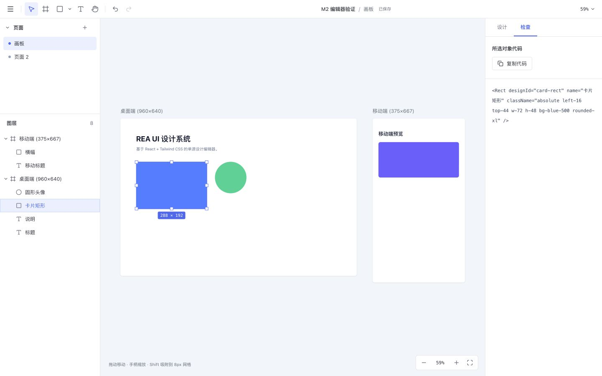
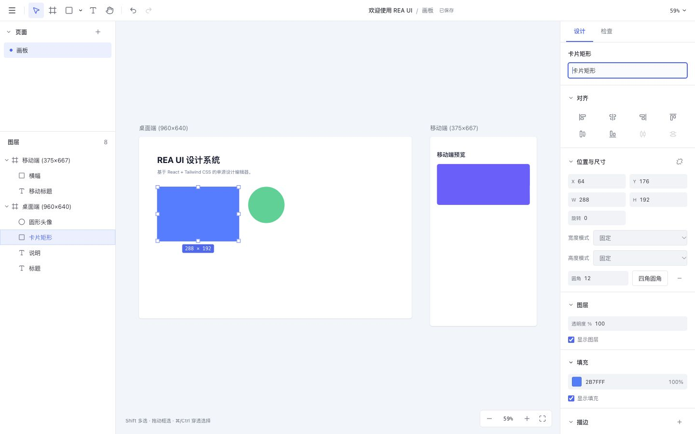

# REA UI

**The design editor whose design source is code.**

REA UI is an open-source, self-hostable design editor where the design source is plain **React TSX + Tailwind** rather than a proprietary format. Edit AI-generated UI directly on a canvas, export production code, or hand the same document back to an AI agent for another round.

[](LICENSE)


[](https://reaui.xtcel.com/#demo)

[简体中文](README.zh-CN.md)



## Why not Figma or v0

| Tool | Output | Edit AI output on canvas | Hand back to AI |
|---|---|---|---|
| v0 / Lovable | Code | Regenerate only | Yes |
| Figma Make / make-real | Image or private file | Yes | Hard to return to code |
| **REA UI** | Canvas + React TSX | Yes | Yes |

The difference is that **`.reaui` is an open exchange format**: any agent that follows the [design protocol](docs/agent-protocol.md) can produce an editable design, and the same file round-trips losslessly between the CLI, the desktop app and the web app.

## Quick start

### 1. Try it in a browser

No install. Open **[reaui.xtcel.com/#demo](https://reaui.xtcel.com/#demo)** to land straight in the editor with the built-in sample design loaded: drag layers, change properties, export TSX. The sample is imported on first visit and edits persist locally in the browser.

Run it locally:

```bash
pnpm build
pnpm --filter @rea/web preview   # http://127.0.0.1:4173/#demo
```

The online build is editor-only. AI generation needs the desktop app, `pnpm dev`, or your own API key. Deployment options are in [web demo](docs/web-demo.md).

### 2. Command line, no install

```bash
npx @xtcel/reaui-cli init ./demo --name "My App" --page main --page-name Home
npx @xtcel/reaui-cli validate ./demo --json
npx @xtcel/reaui-cli pack ./demo --out demo.reaui
npx @xtcel/reaui-cli preview ./demo --out preview.html
```

Two outputs: `demo.reaui` opens in REA UI for further editing, and `preview.html` is a self-contained offline preview you can send to anyone. Package details: [npm](https://www.npmjs.com/package/@xtcel/reaui-cli).

### 3. Desktop app

macOS 12+, Apple Silicon. Install the `.dmg`, then double-click any `.reaui` file in Finder. First launch imports a sample design with 249 editable layers.

### 4. Run from source

Requires Node.js **22.18+**, pnpm **12.4.1** and a stable Rust toolchain.

```bash
rustup target add wasm32-unknown-unknown
pnpm install
pnpm dev
```

Serves `http://127.0.0.1:5173`. Startup compiles WASM first; you can also run `pnpm build:wasm` alone.

```bash
pnpm build       # WASM + TypeScript + web production build
pnpm test        # TSX, transactions, Tailwind, IndexedDB, ZIP, migration, render, WASM
pnpm test:rust   # Rust geometry tests
pnpm preview     # production preview
```

pnpm uses the project-local cache `.pnpm-store/`; the lockfile pins every dependency.

## Desktop development

The desktop app wraps the same React UI and Rust/WASM geometry kernel with Tauri 2, and shares one design source with the web build.

```bash
pnpm desktop:dev        # desktop dev, starts the web dev server
pnpm desktop:build:mac  # Apple Silicon .app and .dmg
pnpm desktop:build      # build for the host architecture
pnpm design:app         # rebuild the editable app-UI design file
```

On first launch the desktop app imports [ReaUI_App.reaui](ReaUI_App.reaui): two pages (home and editor), 249 editable layers. After installing an update, double-clicking a `.reaui` file or choosing "Open With → REA UI" goes straight to the editor, including while the app is already running. You can also use "Import .reaui…" from the main menu. Build environment, output paths, save behaviour and signing status: [desktop notes](docs/desktop.md).

## AI generation

Generate editable UI with a local **Codex CLI** or any **API provider**, with an optional design system, linked project code and `.reaui` references. "Settings" in the home sidebar opens a dedicated window (a real multi-window on desktop; a popup in the browser, falling back to a full page when blocked). Under "Models & providers" you can wire up Codex CLI, Claude Code or Gemini CLI, or enter an OpenAI-compatible, Anthropic, Gemini, DeepSeek, Qwen, Zhipu GLM, Moonshot Kimi, Ollama or custom endpoint with model and API key, then use "Check connection / Test connection" to verify. For local CLIs, run `codex login` in a terminal first.

Both the desktop app and `pnpm dev` support it. Submit a request and it creates a project, opens the editor, streams execution in the left-hand AI session, and mirrors the validated design on the right. Follow-up turns keep editing the same project, with stop, auto-repair and whole-run undo.

Design systems are versioned packages (`schemaVersion` / `revision` / `hash`) with validated tokens and component specs. A document pins a self-contained snapshot at `design/system.json` (manifest v4), and pages reference tokens as `var(--rea-ds-*)`; `reaui validate --system/--strict` reports conformance, and every AI turn records which system revision produced it. See [agent protocol §10](docs/agent-protocol.md).

"Design systems" supports AI generation, semantic colour/type/spacing/radius tokens, component specs, usage guidance and live preview. A linked project is reference only. See [settings](docs/settings.md) and [local agent](docs/local-agent.md) for configuration and real Codex verification commands.

## reaui CLI and AI agents

`packages/reaui-cli` provides browser-free document commands. Validation and packing reuse the editor's own `DocumentSession` and `.reaui` reader/writer, so a file that passes the CLI always opens in the editor. It is the single integration point for external agents.

Published to npm, so any agent can use it without cloning the repo:

```bash
npx @xtcel/reaui-cli init ./demo --name "My App" --page main --page-name Home
npx @xtcel/reaui-cli validate ./demo --json
npx @xtcel/reaui-cli pack ./demo --out demo.reaui
npx @xtcel/reaui-cli preview ./demo --out preview.html
```

Inside the repo use `pnpm reaui` (loads TS through Vite, so source edits take effect immediately). `pnpm build:cli` produces a dependency-free single file at `packages/reaui-cli/dist/reaui.mjs`; the published package ships only `bin` and `dist`. See [CLI distribution](docs/cli-distribution.md).

| Consumer | Integration |
|---|---|
| Codex CLI / Claude Code / other agents | Call the `reaui` command and follow the [design protocol](docs/agent-protocol.md) |
| WorkBuddy | Ships an expert that wraps the CLI, see `integrations/workbuddy/reaui-designer` |
| MCP clients (Claude Code, Cursor, Codex CLI, Cline) | `npx @xtcel/reaui-mcp` — eight tools plus the design protocol as a resource, over stdio or Streamable HTTP. Per-client setup: [agent recipes](docs/agents/README.md) · [MCP server](packages/reaui-mcp/README.md) |

`preview.html` is a self-contained offline preview that opens in the WorkBuddy result pane; `demo.reaui` opens in REA UI for continued editing. Command reference, error codes and delivery rules: [agent design protocol](docs/agent-protocol.md).

The WorkBuddy expert source lives in `integrations/workbuddy/reaui-designer`. To update it, sync that directory to `~/.workbuddy/plugins/marketplaces/my-experts/plugins/` and re-run the expert validation and registration scripts. The skill calls the CLI from `REAUI_ROOT` (default `~/workspace/rea.ui`); set that variable if the repo moves.

## Editing reference

| Action | How |
|---|---|
| Documents | Main menu creates, opens, renames, imports and exports. The "Open document…" list supports duplicate and delete (delete asks for confirmation). Click the document name in the top bar to rename in place |
| Pages | Add in the left rail, double-click to rename, drag to reorder. Context or row menu duplicates and deletes (with confirmation; at least one page is kept) |
| Layer navigation | Listed in canvas stacking order, topmost first. Containers collapse; visibility and lock toggle per layer. Selecting on canvas expands ancestors and scrolls to the row |
| New frame | Drag with the F tool, or click "New frame" with nothing selected |
| Rect / ellipse / text | Press R / O / T then drag; a single click uses the default size. Works inside a frame or directly on the page |
| Images | "Insert image or SVG…" from the menu or toolbar, multi-select PNG / JPG / GIF / WebP / SVG. You can also drop files on the canvas or paste from the clipboard. Bitmaps are placed at native pixel size, scaled down proportionally when larger than the visible area; a drop lands in the frame under the pointer. With an image selected, the right rail offers "Image" to replace the asset and switch `object-fit` |
| SVG import | An `.svg` becomes an editable `Group` of `Rect` / `Ellipse` / `Vector` layers instead of a bitmap asset: transforms are baked into coordinates, single-contour paths open in the pen tool, and fill / stroke / size are editable like any other layer. Unsupported parts (text, embedded bitmaps, masks, clipping, filters) are reported once; gradients fall back to their first stop |
| Export images | "Export image…" from the main menu writes PNG / JPG (1x / 2x / 3x, JPG on white) or a real vector SVG rebuilt from the layers. The range is the selection when there is one, otherwise every frame on the page; multiple files arrive as one ZIP |
| Select / move | V. A single click selects the deepest layer; double-click edits text. The menu beside the move tool switches to "select by hierarchy". Shift-click adds or removes, dragging on empty canvas marquee-selects, ⌘/Ctrl-click selects through. Multi-selection moves as one. Frame titles and layer rows select the whole container |
| Scope navigation | Double-click a container to enter. Enter goes to a child, Shift+Enter selects the parent, Tab / Shift+Tab cycle siblings, Esc clears then walks out level by level, ⌘/Ctrl+A selects everything in the current scope |
| Resize / rotate | Eight handles resize as a group; Shift keeps the ratio, Alt resizes from the centre, minimum 4px. With a single selection, drag just outside a corner to rotate; Shift snaps to 15° |
| Smart guides | Moving, resizing and drawing snap to sibling and parent edges and centres, 6px on screen; ⌘/Ctrl suspends snapping. Shift while moving or drawing keeps an 8px grid. Alt-hover shows distances |
| Rulers / guides | `⌃R` or the "View" menu toggles rulers (off by default). **Hovering a ruler previews** the guide that a click would create (top → vertical, left → horizontal, with a coordinate badge); it disappears on leave. Add a guide by ① **clicking** a ruler, ② dragging out from a ruler, or ③ "Add vertical / horizontal guide" from the View menu or the canvas context menu. Remove one by **dragging it out of the canvas along its normal** (vertical guides left or right, horizontal up or down), or right-click it and choose "Delete this guide". Right-click the top or left ruler to delete all guides of that orientation, and the corner block to clear all. Dragging a guide shows a landing marker on the ruler. Ruler zero is fixed at page world coordinate (0,0); dragging along a ruler axis does nothing. With a selection the ruler marks that layer's span. Guides participate in snapping and are saved in `.reaui` |
| Group / wrap | ⌘/Ctrl+G groups, ⌘/Ctrl+Shift+G ungroups, ⌘/Ctrl+Alt+G wraps in a frame. Selection must be siblings and contiguous |
| Order / parent | ⌘/Ctrl+] and [ move forward and back; add Alt for front and back. Dragging a layer row shows the insertion point. Dragging on canvas into or out of a container reparents automatically; hold ⌘/Ctrl to disable |
| Duplicate / clipboard | ⌘/Ctrl+D duplicates, Alt-drag copies. ⌘/Ctrl+C / X / V copy, cut and paste across pages and documents |
| Edit text inline | With T, type immediately after creating. Double-click text or press Enter to edit; ⌘/Ctrl+Enter or blur commits, Esc discards, Enter inserts a line break. Side handles switch to auto height, corner handles to fixed size |
| Nudge | Arrow keys move 1px, Shift+arrow 10px; consecutive nudges merge into one history entry |
| Design / Inspect | The right rail's "Design" tab edits properties; "Inspect" shows the selected object's current TSX read-only and lets you copy it, or a page summary when nothing is selected. Output past 200 lines is truncated for display; copying returns the full snippet |
| Number fields | Enter / Tab / blur commits, Esc reverts. Accepts `100+20`, `(10+5)*2`, `50%`. Arrow keys or dragging the field label adjusts the value, Shift ×10, Alt ×0.1. With a multi-selection, Mixed steps from each node's own value |
| Colour and appearance | Solid fill, opacity, the default v4 palette and recent colours; stroke inside / centre / outside; drop shadow and inner shadow; layer and background blur. Unknown classes appear read-only under "Other styles" |
| Vector icons | The icon's full viewBox is clickable. The right rail edits the SVG path and viewBox plus fill, stroke, position and size; edits support undo and are saved in `.reaui` |
| Auto layout and text | Frames switch to flex with direction, wrap, gap, four-side padding and 3×3 alignment. Text supports family, weight, size, line height, letter spacing, decoration and sizing mode |
| Align / distribute | The panel offers six alignments plus horizontal and vertical spacing. Alt+A / D / W / S / H / V align, ignored while a field has focus. A multi-selection change is one undo step |
| Delete / undo / redo | Delete; ⌘/Ctrl+Z; ⌘/Ctrl+Shift+Z. Page operations undo as a whole |
| Pan / zoom canvas | H, space or middle-drag; wheel pans; ⌘/Ctrl+wheel zooms; + and − zoom; Shift+1 fits all, Shift+2 fits selection, Shift+0 returns to 100% |
| Save and backup | Debounced autosave to IndexedDB. "Export as .reaui" from the main menu writes the whole document and its assets; a failed save offers the export path |
| Page code / shortcuts | Export the current page's `.tsx` from the main menu, or open the shortcut list |
| Workspace layout | Drag the edges of either rail to resize (200–400px, persisted). The page strip collapses and resizes. Below 900px the rails become mutually exclusive drawers opened from the top bar and closed by tapping the scrim |
| AI sessions | Switch, create and delete sessions from the "AI" header in the left rail. Sessions are saved in `.reaui` and cannot be switched mid-generation |
| Reference canvas elements | The AI button beside "Selection mode" in the toolbar opens an element picker; tick layers to add them to the conversation. A reference defines this turn's edit scope; out-of-scope changes are reported, not blocked |

## Documents and styles

A document is `rea.json`, `pages/<pageId>.page.tsx`, `assets/` and an optional `agent/sessions.json`, exchanged as a single `.reaui` (ZIP) file. Each page is a standalone static TSX file; the manifest stores only page ids, file paths and order. Layers use `Page / Frame / Group / Rect / Ellipse / Text / Image / Vector`. AI sessions travel with the document: one document can hold several, and a recipient still sees the conversation after export or hand-off. Sessions are excluded from design-source validation and from undo history.

All styling lives in Tailwind CSS `className`, for example `absolute left-20 top-16 w-80 h-[200px] bg-blue-500 rounded-lg`. REA UI uses Tailwind **v4 defaults and preflight**, compiled at runtime inside a Shadow DOM. Property edits patch only the affected base utilities and preserve variants and unknown classes.

Source is parsed and validated statically; nothing inside a document is executed. Edits produce candidate files and commit atomically only after all of them pass; undo history records file diffs and restores source exactly.

First launch migrates the legacy localStorage key `rea-ui:tsx-document:v1` (old data is kept). Legacy `.design.tsx` files can be imported from the document list. With no prior data, a sample document with desktop and mobile frames is created.

## Project layout

```text
crates/geometry/   # Rust/WASM geometry
apps/web/          # React/Vite app
packages/
  design/          # primitives and index
  tailwind/        # utility patching, safe filtering, runtime compile
  document/        # static TSX, manifest, transactions, history
  storage/         # IndexedDB, .reaui, autosave, migration
  geometry/        # WASM TypeScript interface
  renderer-dom/    # Shadow DOM / SVG / asset rendering
  editor/          # tools, layers, properties, camera, document management
  reaui-cli/       # browser-free CLI for agents (npm: @xtcel/reaui-cli)
```

See [architecture](docs/architecture.md), [file format](docs/file-format.md), [design system](DESIGN.md) and [verification](docs/verification.md). M3 editing-core implementation and acceptance live in `add-editing-core`; Chinese IME candidate interaction still needs manual acceptance, tracked in the verification log. M4 property-panel field mapping is in the [style reference](docs/styling-reference.md), implemented as `add-property-panel`.

The property panel supports single and multi-selection, numeric preview and atomic undo. Only a single solid fill is supported today; gradients, image fills, custom font loading, blend modes and bitmap export are out of scope for this stage.



## Roadmap

**Shipped:** M1 document model, M2 editor shell, M3 editing core, M4 property panel, `@xtcel/reaui-cli` on npm, `@xtcel/reaui-mcp`, online demo, local-CLI and API-provider AI generation.

**Next**, in priority order:

| Area | Work |
|---|---|
| Distribution | Homebrew cask, signed and notarised desktop build |
| Integrations | Design-system publishing / pinning UI and converter |
| Cloud | Accounts, document sync, version history, commenting |

## Contributing

Issues and PRs are welcome. To keep the main line moving, these directions are **not accepted as PRs**:

- any arbitrary React runtime or execution of code inside a document (the design source must stay statically parseable)
- a second editable design source of truth (everything must land in the existing static-TSX transaction)
- collaboration engine, plugin system, enterprise permissions (these belong to the cloud stage)

If you are unsure whether a change is in scope, open an issue first.

## License

[Apache License 2.0](LICENSE). The `.reaui` format and the CLI are open too; third-party implementations and integrations are welcome.
