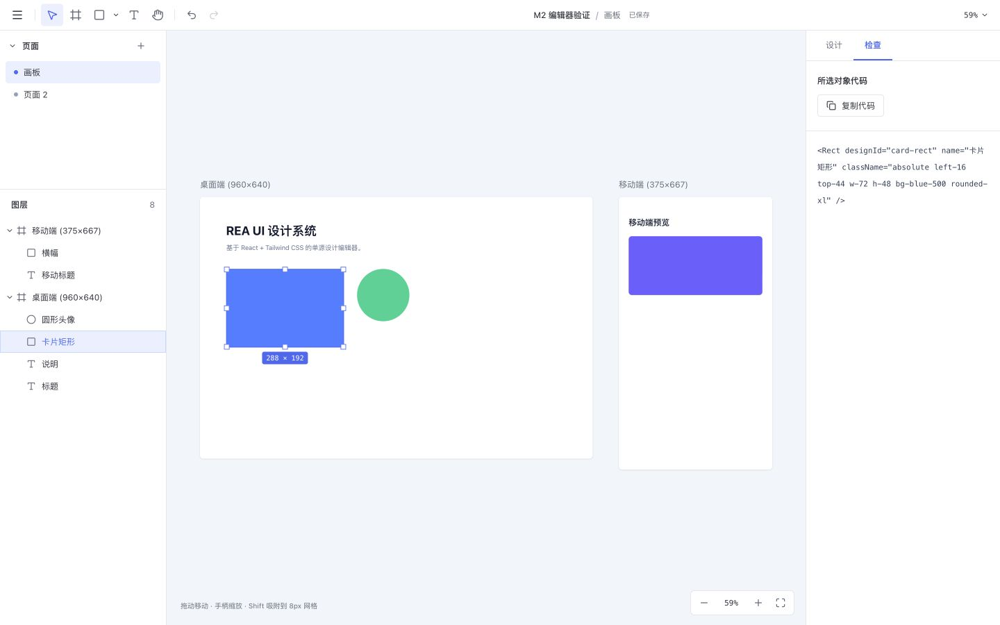
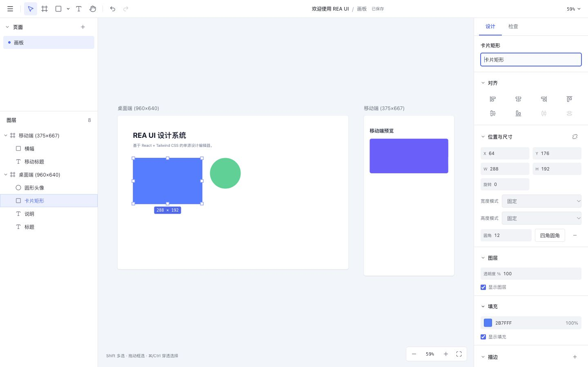

# REA UI

**AI 生成的设计稿，第一次能像设计稿一样改。**

开源、可自托管的 React 单源设计编辑器。设计源是一份真实的 React TSX + Tailwind，而不是私有格式：你可以在画布上直接修改 AI 生成的界面，导出生产代码，也可以把同一份文档交回给 AI agent 继续迭代。

[English](README.md) · 简体中文

[](LICENSE)


[](https://reaui.xtcel.com/#demo)



## 为什么不是 Figma 或 v0

| 工具 | 产物 | 在画布上改 AI 的结果 | 能交回 AI 继续迭代 |
|---|---|---|---|
| v0 / Lovable | 代码 | 只能重新生成 | 是 |
| Figma Make / make-real | 图或私有文件 | 可以 | 难以回到代码 |
| **REA UI** | 画布 + React TSX | 可以 | 是 |

核心差异在于 **`.reaui` 是一个开放的交换格式**：任何 agent 只要按 [设计协议](docs/agent-protocol.md) 生成 TSX，就能产出可编辑设计稿；同一份文件在 CLI、桌面版、Web 版之间无损往返。

## 快速开始

### 1. 在线 demo：浏览器里直接改

不安装任何东西，打开 **[reaui.xtcel.com/#demo](https://reaui.xtcel.com/#demo)** 即可进入内置示例设计稿的编辑器：拖动图层、改属性、导出 TSX。首次访问会自动导入示例，编辑结果存在浏览器本地。

本地跑一遍：

```bash
pnpm build
pnpm --filter @rea/web preview   # http://127.0.0.1:4173/#demo
```

在线版只包含编辑器，AI 生成需要桌面版、`pnpm dev` 或自有 API Key。部署方式见 [在线 demo 说明](docs/web-demo.md)。

### 2. 命令行：零安装，先试一次

```bash
npx @xtcel/reaui-cli init ./demo --name "我的应用" --page main --page-name 首页
npx @xtcel/reaui-cli validate ./demo --json
npx @xtcel/reaui-cli pack ./demo --out demo.reaui
npx @xtcel/reaui-cli preview ./demo --out preview.html
```

得到两份产物：`demo.reaui` 双击用 REA UI 打开继续编辑，`preview.html` 是自包含离线预览，可直接发给他人查看。

### 3. 桌面版：双击 .reaui 继续编辑

macOS 12+、Apple Silicon。下载 `.dmg` 并安装后，在 Finder 中双击 `.reaui` 即可打开；首次启动会导入一份包含 249 个可编辑图层的示例设计稿。

### 4. 从源码运行

要求 Node.js **22.18+**、pnpm **12.4.1** 与 Rust 稳定工具链。

```bash
rustup target add wasm32-unknown-unknown
pnpm install
pnpm dev
```

默认地址 `http://127.0.0.1:5173`。启动会先编译 WASM，也可单独运行 `pnpm build:wasm`。

```bash
pnpm build       # WASM + TypeScript + Web 生产构建
pnpm test        # TSX、事务、Tailwind、IndexedDB、ZIP、迁移、渲染和 WASM 集成测试
pnpm test:rust   # Rust 几何测试
pnpm preview    # 生产预览
```

pnpm 使用项目缓存 `.pnpm-store/`，锁文件固定依赖版本。

## 桌面版开发

桌面版使用 Tauri 2 封装同一套 React 界面和 Rust/WASM 几何内核，与 Web 版共享同一份设计源。

```bash
pnpm desktop:dev        # 本地桌面开发，自动启动 Web 开发服务
pnpm desktop:build:mac  # 构建 Apple Silicon .app 与 .dmg
pnpm desktop:build      # 按当前主机架构构建，macOS 配置输出 .app 与 .dmg
pnpm design:app         # 重建可编辑的应用界面设计稿
```

首次启动桌面版会自动导入 [ReaUI_App.reaui](ReaUI_App.reaui)：包含首页与编辑器两页、249 个可编辑图层。安装新版后，在 Finder 中双击 `.reaui` 或选择「打开方式 → REA UI」即可直接进入编辑器；应用已运行时同样支持。也可在编辑器主菜单中选择「导入 .reaui…」手动打开。构建环境、产物路径、保存方式与签名状态见 [桌面版说明](docs/desktop.md)。

## 本地 AI 生成

支持使用本机 **Codex CLI** 或 **API 提供商**生成可编辑 UI，并选择设计系统、关联本地项目代码、添加 `.reaui` 设计参考。点击首页侧栏「设置」会打开独立的设置窗口（桌面版是多窗口，浏览器是弹出窗口，被拦截时回退为整页设置）：在「模型与提供商」里可以配置 Codex CLI、Claude Code、Gemini CLI 等本地命令，也可以直接填写 OpenAI 兼容、Anthropic、Gemini、DeepSeek、通义千问、智谱 GLM、Moonshot Kimi、Ollama 或自定义接口的地址、模型与 API Key，并用「检测连接 / 测试连接」确认可用。使用本地 CLI 时先在终端运行 `codex login`。桌面版与 `pnpm dev` 均可使用；提交需求后先创建项目、打开编辑器，在左侧 AI 会话中查看执行过程，右侧同步显示通过校验的设计。后续对话继续修改同一项目，支持停止、自动修复与整轮撤销。

「设计系统」支持 AI 生成、语义配色/字体/间距/圆角配置、组件规范、使用指南与实时预览。关联项目只用于生成参考。设置项与窗口行为见 [设置说明](docs/settings.md)，本地 CLI 的配置方法与真实 Codex 复测命令见 [本地 Agent 说明](docs/local-agent.md)。

## reaui CLI 与 AI agent

`packages/reaui-cli` 提供不依赖浏览器的文档命令，校验与打包复用编辑器同一套 `DocumentSession` 与 `.reaui` 封解包，不会出现「CLI 能过、编辑器打不开」。它是外部 agent 接入 REA UI 的唯一入口。

发布到 npm 后，任何 agent 无需克隆仓库即可使用：

```bash
npx @xtcel/reaui-cli init ./demo --name "我的应用" --page main --page-name 首页
npx @xtcel/reaui-cli validate ./demo --json
npx @xtcel/reaui-cli pack ./demo --out demo.reaui
npx @xtcel/reaui-cli preview ./demo --out preview.html
```

仓库内开发用 `pnpm reaui`（通过 Vite 直接加载 TS，改源码立即生效）；`pnpm build:cli` 生成零运行时依赖的单文件 `packages/reaui-cli/dist/reaui.mjs`，发布包只包含 `bin` 与 `dist`。构建与发布流程见 [CLI 分发说明](docs/cli-distribution.md)。

| 场景 | 接入方式 |
|---|---|
| Codex CLI / Claude Code / 其他 agent | 直接调用 `reaui` 命令，按 [设计协议](docs/agent-protocol.md) 产出 TSX |
| WorkBuddy | 内置专家「小瑞」已封装 CLI 调用，见 `integrations/workbuddy/reaui-designer` |
| MCP 客户端（Claude Code、Cursor、Codex CLI、Cline） | `npx @xtcel/reaui-mcp`：八个工具 + 设计协议资源，支持 stdio 与 Streamable HTTP 两种传输。各客户端配置见 [接入示例](docs/agents/README.md) · [MCP server](packages/reaui-mcp/README.md) |

`preview.html` 是自包含离线预览，可直接在 WorkBuddy 结果区打开；`demo.reaui` 双击用 ReaUI 打开继续编辑。命令说明、错误码与交付要求见 [Agent 设计协议](docs/agent-protocol.md)。

专家包源码在 `integrations/workbuddy/reaui-designer`；更新时把该目录同步到 `~/.workbuddy/plugins/marketplaces/my-experts/plugins/`，再用专家校验与注册脚本刷新。技能默认从 `REAUI_ROOT`（缺省 `~/workspace/rea.ui`）调用 CLI；仓库换位置时需设置该环境变量。

## 编辑操作

| 操作 | 方法 |
|---|---|
| 文档管理 | 顶栏主菜单创建、打开、重命名、导入、导出；「打开文档…」列表支持复制与删除，删除需确认；点击顶栏文档名可就地重命名 |
| 页面管理 | 左栏新增、双击重命名、拖拽排序；右键或行末菜单复制、删除；删除需确认，至少保留一页 |
| 图层导航 | 按画布叠放顺序显示（上层在上）；可折叠容器、切换显隐和锁定；画布选择会展开祖先并定位到对应行 |
| 新建画框 | F 工具拖动，或未选择图层时点击「新增画框」 |
| 矩形 / 椭圆 / 文字 | R / O / T 后拖动绘制；单击使用默认尺寸；可放入画框或直接放在页面上 |
| 插入图片 | 主菜单或工具栏「插入图片…」选择 PNG / JPG / GIF / WebP / SVG（可多选）；也可把图片文件拖到画布，或直接粘贴剪贴板图片。按原图像素尺寸放置，超出可见范围等比缩小；拖放落在指针所在画框内。选中图片可在右栏「图片」替换资源、切换 `object-fit` 填充方式 |
| 选择 / 移动 | V；默认单击直接选择深层图层，双击文字编辑；移动工具旁菜单可切换「按层级选择」。Shift 单击加选/减选，空白拖动框选，⌘/Ctrl 单击穿透选择；多选整体移动；画框标题或图层栏可选择整个容器 |
| 范围导航 | 双击容器进入；Enter 进入子级，Shift+Enter 选择父级，Tab / Shift+Tab 切换同级，Esc 清空再逐级退出，⌘/Ctrl+A 全选当前范围 |
| 缩放 / 旋转 | 八方向手柄支持整体缩放；Shift 等比，Alt 从中心，最小 4px；单选四角外侧可旋转，Shift 为 15° 步长 |
| 智能参考线 | 移动、缩放、绘制吸附兄弟节点与父级的边/中心；阈值为屏幕 6px，⌘/Ctrl 暂停；Shift 移动或绘制保留 8px 网格；Alt 悬停看距离 |
| 标尺 / 参考线 | `⌃R` 或「视图」菜单开关标尺（默认关闭）。**指针停在标尺上即预览**该处会创建的参考线（顶部→垂直、左侧→水平，带坐标徽标），移开即消失。添加参考线：①在标尺上**单击**（顶部→垂直、左侧→水平）；②从标尺向画布拖出；③顶栏「视图」或画布空白处右键「添加垂直 / 水平参考线」。删除：把参考线**沿法线方向拖出画布**（竖线左右、横线上下）松手即删，或在参考线上右键「删除此参考线」；顶部 / 左侧标尺右键分别「删除所有垂直 / 水平参考线」，左上角块右键「清除所有参考线」。拖动参考线时标尺上显示落点标记；标尺 0 点固定为页面世界坐标 (0,0)，沿标尺轴向拖动不产生任何效果；选中图层时标尺会标出该图层区间；参考线参与吸附并随 `.reaui` 保存 |
| 编组 / 包裹 | ⌘/Ctrl+G 编组，⌘/Ctrl+Shift+G 取消编组，⌘/Ctrl+Alt+G 用画框包裹；需要同级且连续 |
| 层级 / 父级 | ⌘/Ctrl+] / [ 前移/后移，加 Alt 置顶/置底；图层行拖放显示插入位置；画布拖进/拖出容器自动改父级，⌘/Ctrl 禁用 |
| 复制 / 剪贴板 | ⌘/Ctrl+D 重复，Alt 拖动复制；⌘/Ctrl+C / X / V 复制/剪切/粘贴，支持跨页和跨文档 |
| 直接编辑文字 | T 新建后立即输入；双击文字或 Enter 编辑；⌘/Ctrl+Enter 或失焦提交，Esc 放弃，Enter 换行；左右手柄切换自动高度，角手柄切换固定尺寸 |
| 微移 | 方向键 1px，Shift + 方向键 10px；连续微移合并历史 |
| 设计 / 检查 | 右栏「设计」编辑属性；「检查」只读查看并复制所选对象的当前 TSX，未选择时显示页面概要；超过 200 行仅截断显示，复制取得完整片段 |
| 数值输入 | Enter / Tab / 失焦提交，Esc 还原；支持 `100+20`、`(10+5)*2`、`50%`；方向键或拖动字段标签调值，Shift ×10、Alt ×0.1；多选 Mixed 按各节点原值步进 |
| 颜色与外观 | 纯色填充、透明度、默认 v4 色板与最近颜色；描边内 / 居中 / 外、投影 / 内阴影、图层 / 背景模糊；未知类在「其他样式」只读显示 |
| 矢量图标 | 图标完整视图框可点击选择；右栏可修改 SVG 路径和视图框，以及填充、描边、位置和尺寸；修改支持撤销与 `.reaui` 保存 |
| 自动布局与文字 | Frame 可切换 flex、方向、换行、间距、四边内边距与九宫格对齐；文字可修改字体、字重、字号、行高、字间距、装饰与尺寸模式 |
| 对齐 / 分布 | 面板提供六种对齐和水平 / 垂直等间距；Alt+A / D / W / S / H / V 对齐，输入框内不触发；多选修改一次撤销 |
| 删除 / 撤销 / 重做 | Delete，⌘/Ctrl+Z，⌘/Ctrl+Shift+Z；页面操作也可整体撤销 |
| 平移 / 缩放画布 | H、空格或中键拖动；滚轮平移；⌘/Ctrl+滚轮缩放；+ / − 缩放；Shift+1 适应全部，Shift+2 适应选中，Shift+0 回到 100% |
| 保存与备份 | IndexedDB 防抖自动保存；主菜单「导出为 .reaui」保存整个文档与资源；保存失败提供导出入口 |
| 页面代码 / 快捷键 | 主菜单导出当前页面 `.tsx`，或打开快捷键一览 |
| 工作区布局 | 拖动左右栏边缘调宽（200–400px，刷新保留）；页面区域可折叠、调高；小于 900px 时通过顶栏打开互斥抽屉，点击遮罩关闭 |
| AI 会话 | 左栏「AI」标题右侧切换、新建、删除会话；会话随 `.reaui` 保存，生成期间不可切换 |
| 引用画布元素 | 工具栏「选择方式」右侧的 AI 按钮打开元素选择器，勾选图层加入对话；引用即本轮修改范围，越界改动只提示不拦截 |

## 文档与样式

文档由 `rea.json`、`pages/<pageId>.page.tsx`、`assets/` 和可选的 `agent/sessions.json` 组成，使用 `.reaui`（ZIP）作为单文件交换格式。每个页面是独立的静态 TSX 文件，清单只存页面 id、文件路径和顺序。图层使用 `Page / Frame / Group / Rect / Ellipse / Text / Image / Vector`。AI 会话随文档保存：一个文档可有多条会话，导出或转交 `.reaui` 后对方仍能看到历史对话，会话不参与设计源校验，也不进入撤销历史。

样式全部写入 Tailwind CSS `className`，例如 `absolute left-20 top-16 w-80 h-[200px] bg-blue-500 rounded-lg`。使用 Tailwind **v4 默认主题和 preflight**，运行时编译在 Shadow DOM 中隔离。属性编辑只修补对应基础类，保留变体与未知类。

源码静态解析并校验，不执行文档内代码。修改先生成候选文件，全部通过后原子提交；撤销历史记录文件差异，精确恢复源码。

首次启动会迁移旧 localStorage `rea-ui:tsx-document:v1`（旧数据保留）。也可从文档列表导入旧 `.design.tsx`。没有旧数据时自动创建含桌面、移动端两个画框的示例。

## 工程结构

```text
crates/geometry/   # Rust/WASM 几何
apps/web/          # React/Vite 应用
packages/
  design/          # 原语与索引
  tailwind/        # 属性组修补、安全过滤、运行时编译
  document/        # 静态 TSX、清单、事务与历史
  storage/         # IndexedDB、.reaui、自动保存和迁移
  geometry/        # WASM TypeScript 接口
  renderer-dom/    # Shadow DOM / SVG / 资源渲染
  editor/          # 工具、图层、属性、相机和文档管理
```

详见 [架构说明](docs/architecture.md)、[完整文件格式](docs/file-format.md)、[设计系统](DESIGN.md)、[验证记录](docs/verification.md)。M3 编辑核心的实现和验收记录见 `add-editing-core`；系统中文输入法候选交互仍待人工验收，详见验证记录。M4 属性面板的字段映射见 [样式对照表](docs/styling-reference.md)，实现与验收对应 `add-property-panel`。

属性面板支持单选与多选、数值预览和原子撤销。当前仅支持单个纯色填充；渐变、图片填充、自定义字体加载、混合模式和导出位图不在本阶段范围。



## 路线图

**已完成**：M1 文档模型、M2 编辑器外壳、M3 编辑核心、M4 属性面板、reaui CLI、MCP server、在线 demo、本机与 API 两种 AI 生成方式。

**接下来**（按优先级）：

| 阶段 | 内容 |
|---|---|
| 开箱即用 | Homebrew cask、桌面版签名与公证 |
| 接入面 | 主流 agent 集成示例、设计系统转换器 |
| 云端 | 账号、文档同步、版本历史、协作评论 |

## 参与贡献

欢迎 issue 与 PR。为保证主线可推进，以下方向**暂不接受 PR**：

- 引入任意 React 运行入口或执行文档内代码（设计源必须保持静态可解析）
- 第二套可编辑设计真源（所有能力必须落在现有静态 TSX 事务上）
- 协作引擎、插件系统、企业权限（属于云端阶段）

不确定某项改动是否在范围内，请先开 issue 讨论。

## 许可证

[Apache License 2.0](LICENSE)。`.reaui` 文件格式与 CLI 同样开源，欢迎第三方实现与集成。
