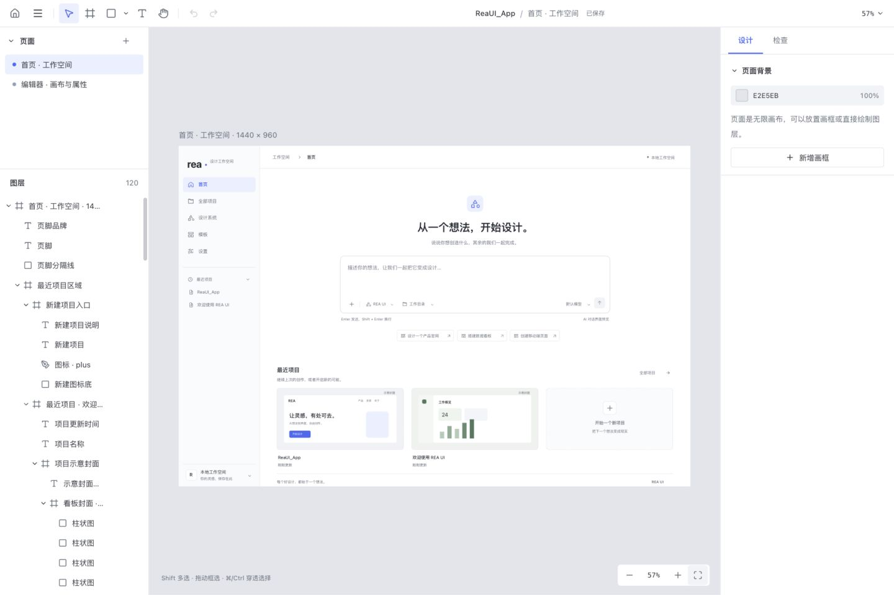

# macOS 桌面版

REA UI 使用 Tauri 2 提供 macOS 12+、Apple Silicon（arm64）桌面应用。原生入口位于 `src-tauri/`，前端复用 `apps/web/` 和现有编辑器包，几何计算继续使用 Rust 编译的 WASM。

## 开发与打包

在已安装 Xcode 命令行工具的 Apple Silicon Mac 上，准备 Node.js 22.18+、pnpm 12.4.1 与 Rust 稳定工具链（1.90+）：

```bash
rustup target add wasm32-unknown-unknown aarch64-apple-darwin
pnpm install
pnpm desktop:dev
```

`desktop:dev` 自动运行 `pnpm dev`，先编译 WASM，再启动 Vite 和原生窗口。生产构建自动运行 `pnpm build`，完成 WASM、TypeScript 检查和 Web 构建后封装应用。

```bash
pnpm desktop:build:mac  # 指定 aarch64-apple-darwin，输出 app、dmg
pnpm desktop:build      # 使用当前主机架构；macOS 配置同样输出 app、dmg
```

本次已成功生成：

| 产物 | 路径 |
|---|---|
| 应用 | `target/aarch64-apple-darwin/release/bundle/macos/REA UI.app` |
| 安装镜像 | `target/aarch64-apple-darwin/release/bundle/dmg/REA UI_0.1.0_aarch64.dmg` |

可从 Finder 打开 `.app`；DMG 内提供应用安装入口。当前产物用于本机测试，仅有链接器临时签名，尚未进行 Developer ID 签名或 Apple 公证。

## 打开和编辑应用设计稿

[ReaUI_App.reaui](../ReaUI_App.reaui) 是当前首页和编辑器界面的可编辑复刻，包含两个 1440 × 960 画框、249 个图层。文字、矩形、椭圆、容器和矢量图标均为编辑器原生图层；画稿中的按钮和输入框用于界面参考，不执行应用交互。



1. 首次启动桌面版后，在首页项目中打开 `ReaUI_App`。内置示例在同一份应用数据中只导入一次，保留已有项目。
2. 左栏切换「首页 · 工作空间」与「编辑器 · 画布与属性」，按 `Shift+1` 适应全部画框。
3. 默认在画布单击即可直接选中深层文字、形状与图标，双击文字进入输入；移动工具旁菜单可切换「按层级选择」。画框标题和图层栏可选择整个容器。在右栏「设计」中修改位置、尺寸、文字和外观；矢量图标还可修改 SVG 路径与视图框；「检查」可查看、复制当前 TSX。
4. 通过编辑器顶栏主菜单「导出为 .reaui」保存完整文档，或「导出当前页面代码 (.tsx)」保存页面源码。

安装新版桌面应用后，Finder 双击 `.reaui` 或「打开方式 → REA UI」会读取文档并直接进入编辑器，支持应用首次启动和运行中打开。启动期间的请求会保留至本地存储和编辑器就绪，多文件请求依次打开；读取或解析失败时显示具体文件名和原因，并保留当前文档。macOS 文件关联由安装后的应用包注册，旧安装包需要替换。

浏览器版不会自动安装该示例。手动导入时，先从首页打开或新建项目进入编辑器，再打开主菜单「导入 .reaui…」，在文件选择器中选择仓库根目录的 `ReaUI_App.reaui`。删除内置示例后也可用此方法重新导入。

可读源码位于 `examples/ReaUI_App/`，包含 `rea.json` 与 `pages/*.page.tsx`。修改生成脚本 `scripts/build-app-design.mjs` 后运行：

```bash
pnpm design:app
```

此命令会重建根目录 `.reaui` 和示例源码；已导入的本地文档需要手动重新导入更新。

## 保存与数据位置

桌面首页现支持本机 Codex CLI。设置中可检测安装与登录、指定路径和模型；「关联项目」打开系统文件夹选择器，读取项目作为设计参考。设计系统与 AI 生成的配置、测试方式见 [本地 AI 生成说明](local-agent.md)。运行模块已编入 Tauri，无需另启桥接服务。

编辑内容自动保存到应用 WebView 的 IndexedDB，与浏览器中的文档库相互独立。跨桌面版与浏览器版传递文档时，使用 `.reaui` 导出、导入。

桌面版导出 `.reaui` 或 `.tsx` 时打开系统保存对话框，仅向用户选择的路径写入文件；取消对话框不会写入。通过 Finder 打开与手动导入一样，会创建本地文档副本；编辑后通过「导出为 .reaui」保存到文件。导入也支持旧 `.design.tsx` 文档迁移。

编辑器关闭窗口前会等待自动保存完成；保存失败时保留窗口并提示导出备份。该保护针对窗口关闭请求，尚未验证覆盖 `⌘Q` 退出应用。

## 验证与视觉延续

此前桌面版已验证原生启动、内置设计稿、系统对话框导出 ZIP、浏览器导入及 `.reaui` 导出再导入。

文件打开与编辑修复已通过 TypeScript 检查、253 项 TypeScript 测试和 3 项桌面端 Rust 测试，覆盖冷启动请求、运行中请求串行处理、坏文件恢复、深层选择、SVG 命中、应用两页的文字和矢量修改、撤销与文件往返。实际在 macOS Finder 双击测试文件，已确认首次启动直接进入编辑器、运行中切换文档、坏文件提示并保留当前文档、单击深层图层和双击编辑中文。实际将图标描边从 1.65 改为 2.5，通过系统对话框导出、退出应用并双击导出文件重开后，描边数值和无填充状态均保留。

本次 `.app` 生产构建成功；DMG 打包的 `hdiutil create` 遇到本机“设备未配置”错误，可直接使用构建出的 `.app`。

桌面版和设计稿沿用既有白灰表面、蓝色状态、系统字体及轮廓图标。对照现有 `DESIGN.md`、主题与实现后，本次保留 `DESIGN.md` 和 `.impeccable/design.json`，不新增全局视觉令牌。最终审查结论为可交付，原生窗口及两页画稿的复查截图位于 `.impeccable/review/desktop/`。
