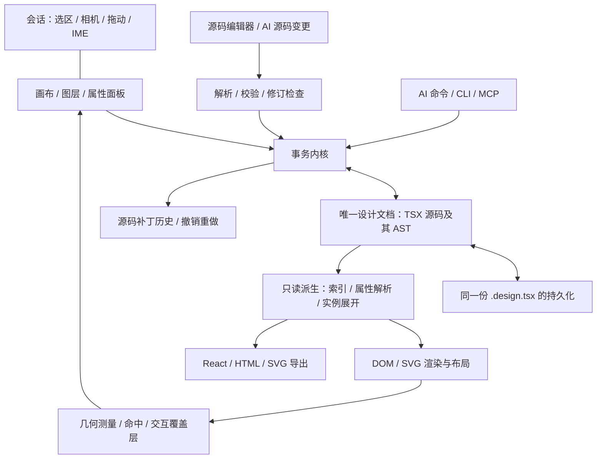

# RFC-001：React 单源专业设计编辑器

> 正式提案 · v1.0 · 2026-11-02 · 状态：待评审  
> 项目代称：REA UI；不构成最终产品命名。  
> 本文规定拟议架构与验收契约，不代表相关 API 或编辑器已经实现。

## 1. 提案摘要

建设一个独立的 React / TypeScript 专业设计编辑器。人类通过画布、图层与属性面板编辑，AI 通过源码或命令编辑；两者操作同一份 `.design.tsx` 设计文档。AST 是该源码的内存表示，所有布局、DOM、SVG、命中索引与预览均可从源码重新生成。

**FigCraft 仅作为 UI 参考。文档模型遵循《节点 Schema 与命令清单（草案 v0.1）》的 React 方向，不采用 FigCraft 的节点模型、文件格式、存储约定或原生文档协议。** 本项目不建设 `.figcraft` 与 TSX 之间的双向转换系统。

产品同时面向专业界面设计与专业矢量设计，分阶段交付。首先打通可靠的单源编辑闭环，再完善组件、响应式、排版、路径、合成与团队能力。以真实编辑场景和明确的退出标准决定阶段推进，不以文件后缀或静态演示代替能力验收。

| 决策 | 本提案采用的方向 | 依据与状态 |
|---|---|---|
| 实施方式 | 独立 React / TypeScript 编辑器 | 用户已确认 |
| 几何内核补充决策 | Rust/WASM 负责绘制、拖动吸附和缩放几何；TSX 仍是唯一设计文档 | 用户于本次基础编辑升级中确认 |
| FigCraft 的作用 | UI 参考，包括画布、工具区、图层与属性面板的体验研究 | 用户最新明确约束 |
| 唯一设计源 | `.design.tsx`；AST 为其内存形式 | 草案要求，延续会话的单源原则 |
| 能力目标 | 专业 UI 与矢量工具，分阶段实现 | 用户已确认 |
| 首期作者语言 | 受控声明式 TSX，提供 React 设计原语与静态 Tailwind 写法 | 本提案对草案的具体化 |
| 首期渲染 | DOM + SVG 内容渲染，独立交互覆盖层 | 建议决策，须通过原型验证 |
| 源码编辑 | 语义 AST 操作 + 保留原文的局部写回 | 建议决策，解析/打印组合待 P0 实测 |
| 协作演进 | 首期文档修订与原子事务；多人算法另立 RFC | 建议决策 |

## 2. 背景、目标与范围

### 2.1 要解决的问题

AI 擅长生成与修改 Web 源码，人类设计师需要稳定的选择、布局、组件、文本和矢量操作。本项目让这些能力建立在同一份可读、可审查、可版本管理的 React 设计文档上。

统一源文档后，主要工程任务是确定每个专业操作如何修改源节点，并提供可靠的交互与渲染。节点身份、样式归属、实例覆盖、响应式作用域、撤销与临时输入都必须有明确语义。

### 2.2 产品目标

1. 人类与 AI 可以连续交替编辑，节点身份、组件关系、Token 与矢量结构持续保留。
2. 支持自由布局、Flex、Grid、组件/实例/变体/插槽与多视口响应式设计。
3. 支持可继续编辑的路径、控制柄、非破坏布尔、蒙版、多重外观与富文本。
4. 每次文档变更可校验、可解释、可撤销；失败变更不影响已提交文档。
5. 可导出普通 React / HTML + CSS + SVG，并报告不支持或需降级的能力。
6. 独立编辑器与文档服务可本地运行，并逐步支持私有部署。

### 2.3 首期边界

首期只承诺受支持的声明式 TSX 设计子集。任意业务 React、Hooks、函数执行、动态 className、数据请求与第三方组件内部编辑不属于首期契约。后续通过明确的代码组件注册与 `Repeat` 等设计节点扩展。

首期不承诺 Figma/Sketch 全能力、完整原型交互、任意网页无损导入、任意 CSS 的 GPU 等价渲染或多人离线合并。UI 可以参考 FigCraft，文档与命令语义必须由本 RFC 及其 React 草案推导。

### 2.4 文档与工程交付范围

本文交付架构、Schema 契约、命令边界、阶段计划和验收标准。工程实现从 P0 验证开始。团队人数、预算与日历排期尚未提供，因此本提案不承诺完成日期；阶段依赖与退出标准可用于后续估算。

## 3. 架构约束

以下约束应成为代码评审与架构评审的检查项。

| 编号 | 必须满足的约束 |
|---|---|
| A1 | 所有可编辑设计语义保存在 `.design.tsx` 中；不另建可独立编辑的设计 JSON 或原生文档。 |
| A2 | AST、节点索引、组件展开结果、布局与渲染缓存均可重建；不可成为第二个写入入口。 |
| A3 | UI、源码编辑器、AI、CLI/MCP 经同一事务内核提交；不得直接修改渲染结果来保存设计。 |
| A4 | FigCraft 仅提供 UI 参考；不得把其节点字段、序列化格式或协作协议带入本项目模型。 |
| A5 | 节点使用源码内显式身份；移动和重排保留身份，复制创建新身份。 |
| A6 | 文档状态、临时交互状态与派生数据有明确生命周期。 |
| A7 | 一个用户意图对应一个文档事务；成功整体提交，失败整体不变。 |
| A8 | 不支持的语法或能力必须返回诊断，不得静默丢弃或伪装成已可编辑。 |
| A9 | 导出产物是派生结果；修改导出代码不会自动成为新的设计源。 |
| A10 | 每项技术结论区分已有证据、提案决策与待验证结果。 |

“唯一设计源”不禁止资源文件、会话偏好、源码历史或日志。它要求这些文件不重复持有可独立修改的当前设计语义。

## 4. 系统架构



### 4.1 模块职责

| 模块 | 职责 | 输出或边界 |
|---|---|---|
| `document` | TSX 语法、AST 操作、局部写回、版本迁移 | 源码及其解析结果 |
| `schema` | 节点、属性、Token、参数与引用规则 | 可供运行时和面板共同使用的规范 |
| `commands` | 命令前置条件、事务、修订校验、历史 | 唯一文档变更入口 |
| `style` | 支持的 Tailwind/CSS 属性映射、断点与覆盖解析 | 可重建的样式计划和 CSS |
| `renderer-dom` | DOM/SVG 呈现、字体/图片就绪、布局测量 | 带修订号的渲染与测量结果 |
| `interaction` | 工具状态机、选择、命中、坐标换算、吸附、拖动预览 | 会话状态与提交命令 |
| `editor` | 应用界面、图层、面板、源码、诊断与历史视图 | 依赖公共命令 API |
| `exporter` | 普通 React/HTML/CSS/SVG 输出及能力诊断 | 派生文件，不反向写入文档 |
| `document-service` | 文件读写、CAS、修订、资源、恢复与接口接入 | 首期每文档一个提交序列 |

以上目录为建议组织方式，不意味着必须拆成九个独立进程或发布包。

### 4.2 状态归属

| 状态 | 保存位置 | 是否设计事实 |
|---|---|---|
| 节点、布局规则、组件、Token、外观、路径、页面视口 | `.design.tsx` | 是 |
| 字体和图片内容 | 资源文件，源码保留唯一引用 | 是，作为外部资源依赖 |
| 相机、悬停、选区、工具、临时控制柄 | 会话内存，可保存用户偏好 | 否 |
| 未完成源码输入、拖动预览、IME 组合文本 | 未提交缓冲区 | 否，不替换已提交版本 |
| AST 索引、展开实例、布局、CSS、路径缓存、缩略图 | 内存或可删除缓存 | 否 |
| 历史补丁、快照、恢复日志 | 历史存储 | 历史证据，不是另一份当前设计 |

首期项目以一个 `.design.tsx` 容纳一个设计文档及其组件和页面。后续拆分文件时，必须保留显式模块归属和跨文件事务；本 RFC 不提前承诺跨文件组件库的全部编辑语义。

建议项目结构：

```text
project/
├── main.design.tsx       # 唯一当前设计文档
├── assets/               # 图片、字体等不可由 AST 推导的资源
├── design.config.json    # 工具链版本、资源根等；不保存节点/Token/布局
└── .rea/                 # 可重建缓存、会话偏好、源码历史与恢复信息
```

## 5. TSX 文档契约

### 5.1 允许的语法

采用 `.design.tsx` 的声明式设计语言：允许指定设计运行库的静态具名 import、一个默认导出的 `<DesignDocument>`、白名单 JSX 节点、文本以及静态属性字面量。允许对象、数组、字符串、有限数值、布尔值、`null` 和负数字面量；禁止对象 spread、计算属性、函数、任意成员访问、调用表达式与运行期求值。

注释、缩进、引号和未知的合法 `data-*` 属性须保留。`data-*` 值仅允许静态、可序列化的数据，不是草案中的任意 JavaScript。未知设计节点或普通属性返回诊断；注册扩展节点需要独立 Schema、渲染与导出声明。

`binding`、Token 引用和实例参数是专用语法，不通过 `eval` 或执行用户模块解释。`.design.tsx` 使用 React/JSX 的作者形式，但不是任意 React 应用；真实业务 React 的接入将在独立协议中定义。

### 5.2 根结构与身份

| 元素 | 数量/身份 | 契约 |
|---|---|---|
| `DesignDocument` | 恰好一个；`version={1}` | `breakpoints` 定义命名断点；版本决定解释规则 |
| `Tokens` | 0..n | 合并为同一名称空间；重复 key 拒绝，不能依声明顺序覆盖 |
| `Component` | 0..n；`designId` 与可读 `id` | `designId` 稳定；`id` 是组件名称，引用必须存在且无循环 |
| `Page` | 1..n；`designId` 与可读 `id` | 内容与视口声明；不同视口呈现同一内容树 |

所有设计节点（包括 `Frame`、`Text`、`Span`、`Instance`、`Slot` 等）使用文档内唯一 `designId`。根、Token 声明与几何/外观辅助记录分别通过根地址、Token key、所属节点加局部 ID 寻址，不强迫使用同一身份空间。

`designId` 保留草案正则 `[a-z][a-z0-9-]{1,63}`。新建采用类型前缀和 128 位随机值的小写编码；创建后不得因重排或改名而变化，提交时仍检查唯一性。直接源码改 ID 被视为删除与新增，不根据名称猜测同一节点；需要延续引用时使用显式身份迁移命令。

### 5.3 最小完整示例

以下示例全部为拟议接口；包名 `@rea/design` 尚未发布。

```tsx
import {
  DesignDocument, Tokens, Component, Page, Frame, Text, Instance,
} from "@rea/design";

export default (
  <DesignDocument version={1} breakpoints={{ md: 768, lg: 1024 }}>
    <Tokens values={{
      accent: { type: "color", value: "#2563eb" },
      space: { type: "dimension", value: 24 },
    }} />

    <Component
      designId="component-button"
      id="Button"
      parameters={{ label: { type: "string", default: "按钮" } }}
    >
      <Frame
        designId="button-root"
        layout="flex"
        direction="row"
        padding={12}
        className="rounded-lg bg-accent"
      >
        <Text designId="button-label" binding="label" className="text-white" />
      </Frame>
    </Component>

    <Page
      designId="page-home"
      id="home"
      viewports={[
        { id: "mobile", width: 390, height: 844 },
        { id: "desktop", width: 1440, height: 900 },
      ]}
    >
      <Frame
        designId="home-root"
        layout="flex"
        direction="column"
        gap="token:space"
        className="p-6 md:p-8"
      >
        <Text designId="home-title">设计与代码共用一份文档</Text>
        <Instance
          designId="home-cta"
          component="Button"
          values={{ label: "开始" }}
        />
      </Frame>
    </Page>
  </DesignDocument>
);
```

### 5.4 节点族与子节点规则

| 节点 | 子节点/职责 | 主要约束 |
|---|---|---|
| `Page` | 一个或多个根 `Frame` | 根 Frame 按源码顺序排布；每个视口有独立浏览上下文 |
| `Frame` | 可布局的视觉节点，及一个可选 `Appearance` | `layout="free\|flex\|grid"`；定义子节点布局规则 |
| `Group` | 视觉节点的逻辑组合 | 不引入布局盒；不能拥有 padding/gap/裁剪/外观 |
| `Text` | 文本、`Span`、`Break` 及可选 `Appearance` | 静态内容与 `binding` 互斥；文本结构可继续编辑 |
| `Span` | 文本与受支持行内节点 | 有身份，样式作用于行内范围 |
| `Break` | 无 | 显式换行，使用 designId 参与文本范围定位 |
| `Image` | 无 | `src`、`alt`、`fit`；资源引用须解析 |
| `Component` | 恰好一个根视觉节点 | 可包含命名 `Slot`；非页面直接绘制节点 |
| `Instance` | 可选 `SlotContent` | `component`、`values`、`variant`、`overrides`；不保存展开副本 |
| `Slot` | 默认内容 | 仅用于组件定义；`slotId` 在该组件内唯一 |
| `SlotContent` | 插槽填充的真实源节点 | 仅位于 Instance 下；以 `slotId` 对应声明 |
| `Vector` | `d` 字符串或网络几何，及可选 `Appearance` | 两种几何作者形式互斥 |
| `BooleanOp` | 至少两个 Vector/BooleanOp | `union/subtract/intersect/exclude`，减法按子节点顺序 |
| `Mask` | 恰好两个视觉节点 | 第一项为遮罩，第二项为内容；可用 Frame 容纳多个对象 |

`Appearance`、`Anchor`、`Segment`、`Region` 等为元数据/几何子节点，不是布局项目。源码顺序中的视觉子节点才参与重排索引。

`hidden` 在 v1 定义为不绘制、不命中、不占布局；若后续需要“隐藏但保留布局”，引入独立属性，不复用此含义。`locked` 是编辑交互规则：祖先锁定向下生效，普通选择与修改受限；图层面板仍可定位、查看并显式解锁。

### 5.5 布局、定位与尺寸

必须区分父节点的布局方式和子节点的定位方式，修正草案中“父级 `position=absolute`”的歧义。

| 概念 | 提案定义 |
|---|---|
| 父布局 | `Frame.layout="free\|flex\|grid"` |
| 子定位 | `position="flow\|absolute"`；free 子节点默认 absolute，flex/grid 子节点默认 flow |
| 坐标 | `x/y` 为绝对节点相对所属 Frame 内容盒的 CSS px 坐标；不包含编辑器相机变换 |
| 旋转 | `rotation` 为角度，默认绕中心；可用于流内节点，旋转不改变其布局占位 |
| 尺寸策略 | 每轴 `fixed / hug / fill`；fixed 需要有限非负尺寸值 |
| 父子依赖 | 无法确定的 hug/fill 循环返回错误；不得悄悄改变父级策略 |
| Resize | 指明锚点及新尺寸策略；hug/fill 改 fixed 必须在提交意图中明确 |
| 响应式 | 明确 `base` 或命名 breakpoint 作用域，画板名称本身不是样式条件 |

边框盒、内容盒、屏幕坐标和局部坐标在测量接口中显式标注。拖动先逆相机矩阵，再逆父节点变换，得到本地改变量；不能把屏幕上的 12px 直接写成源节点的 12px。

Group 是逻辑结构，不创建 DOM 布局盒，也不保存独立变换。初期只允许对同父级、绘制顺序连续、可变换的绝对定位节点成组；移动/缩放 Group 转为对子节点的原子变更。非连续选择可能改变叠放顺序，默认拒绝，不能假定只保持坐标就保持视觉结果。流布局分组使用明确的 `WrapInFrame`，因为增加布局容器可能改变排版。跨父级自动归并和旋转/非均匀缩放后的复杂成组不纳入初期保证。

### 5.6 Tailwind、style 与专用属性的归属

采用“每个作用域、每个 CSS 长属性只有一个作者来源”的规则。专用 props、静态 Tailwind 类和 `style` 都可输入，但不得在同一个声明层和条件下同时拥有相同属性。

1. 支持的 Tailwind 类映射到规范属性；布局 props、style 和简写属性也展开到相同属性键。
2. 同作用域存在重叠作者来源时返回 `STYLE_CONFLICT`，指出源码位置；不按 class 字符串位置猜赢家。
3. `base` 与 `md` 是不同条件，允许按条件覆盖。v1 支持固定的 min-width 断点，值必须唯一且递增；更大的命中断点优先。
4. 面板编辑保留原作者形式：已有 `gap-4` 则替换相应类；已有 `gap={16}` 则修改 prop。新增时布局/尺寸优先专用 props，普通样式优先静态类，支持范围内的剩余属性使用 style。
5. 解析结果统一生成作用域 CSS。`style` 是设计语言中的静态属性输入，不原样变成压过所有断点的 DOM inline style；导出使用相同解释规则。
6. 首期仅允许已登记的 utilities、字面量 arbitrary values 与断点组合；任意插件 CSS、`!important`、动态拼接和未登记选择器不进入可编辑子集。

例如 `gap={16}` 与 `className="gap-4"` 同时出现是冲突；`gap={16}` 与 `className="md:gap-8"` 合法。`p-4` 与 `px-2` 在 v1 同一层发生长属性重叠，需显式规范化为不重叠的四边/两轴声明，不能默默保留歧义。

组件样式按“定义 → 所选 variant → 当前实例 override”逐层覆盖；每层内部先解析 base，再解析命中断点。实例 base override 因层级更高，会覆盖定义层的响应式同属性值。参数绑定先提供值，随后按该顺序解析可覆盖属性；绑定 Text 的内容须改参数，不能以普通文本 override 绕过绑定。

这套规则是本项目的设计语言契约，不声称等同于任意 React 应用的 CSS cascade。Tailwind 版本、主题规则和支持矩阵须锁定；草案未规定的默认间距和字体不能依环境推断。Tailwind 官方说明其类名检测依赖源码中的完整静态字符串，支持采用静态 className 的边界。[Tailwind 文档](https://tailwindcss.com/docs/detecting-classes-in-source-files)

### 5.7 Token 与文本样式

Token 使用有类型定义：`color`、`dimension`、`number`、`fontFamily`、`textStyle`、`shadow` 等。`token:name` 必须存在且类型兼容；维度型数值默认单位为 CSS px。`textStyle="heading.l"` 引用 `textStyle` 类型 Token，不能只是未声明的字符串。文本样式展开后的属性同样参与归属检查；v1 对同层局部冲突给出诊断，后续如需逐属性覆盖文本样式，应采用显式覆盖字段。

允许 Token 别名，但引用图必须无环。删除或重命名被使用的 Token 默认拒绝；显式替换全部引用或转常量属于一个事务。Token 到 CSS 变量名的编码必须可逆且避免碰撞，不能只把点替换成连字符。

### 5.8 组件、实例与覆盖寻址

`Component.parameters` 使用有类型参数声明，包含可选默认值；v1 支持 string、number、boolean 与枚举。`values` 按键和类型校验，缺失必填参数拒绝。

`variants` 在 P2 采用命名变体集合，每个变体包含与 overrides 相同形式的目标/属性条目；一个实例一次选择一个命名变体，未指定时只使用定义值。首版不隐含多轴变体的组合优先级，多轴组合需要另行补充协议。`Slot.accepts` 声明可接受的节点种类，缺省允许普通视觉节点；SlotContent 的真实子树具有自己的 designId，不与定义中的默认内容共用身份。

定义中每个源节点只有一个身份。同一组件显示 100 次不会在源码中产生 100 份内部节点；显示身份需要包含实例路径与视口。

```ts
type EditTarget =
  | { kind: "source"; designId: string }
  | { kind: "instance"; instanceId: string; path: string[] };

type RenderAddress = {
  pageId: string;
  viewportId: string;
  instancePath: string[];
  sourceDesignId: string;
};
```

简单覆盖的 `path` 只有目标定义节点 ID；穿过嵌套实例时，先记录每个实例节点 ID，再记录末端定义节点 ID。不得使用 DOM 顺序、图层名或一次运行的 React key 推断目标。

建议将草案的 `overrides` 字典升级为显式目标列表，以容纳嵌套实例路径：

```tsx
<Instance
  designId="home-cta"
  component="Button"
  values={{ label: "开始" }}
  overrides={[
    { target: ["button-root"], props: { className: "bg-red-600" } },
  ]}
/>
```

这里的 className 覆盖按解析后的属性合并：只覆盖 background-color，不删除定义中的圆角或 padding。ResetOverride 删除覆盖条目/属性并恢复继承值。相同目标和条件下重复覆盖同一属性拒绝。

首期覆盖仅限 Schema 允许的属性，不能改 `designId`、组件引用、绑定关系或任意子树。结构变化通过已声明 Slot 或编辑主组件完成；拆离实例属于后续显式命令。删除定义节点时，如存在实例覆盖或参数绑定引用，必须报告引用位置并要求同事务修复。

画布编辑实例内绑定文字时，修改外层实例参数；普通实例内文字修改写入内容覆盖；进入“编辑主组件”后才修改定义。多级参数透传若未实现，返回明确诊断，不自动修改最内层共享定义。

### 5.9 矢量几何

Vector 允许 `d` 与网络结构两种互斥作者形式。首次节点级编辑 `d` 时，显式 `ExpandPath`，或在同一事务中“展开 + 编辑”；撤销须恢复原始 path 文本。

草案中每个 Anchor 一组 in/out Handle 不足以表示分支向量网络。因此控制柄改为属于 Segment 端点：

```tsx
<Vector designId="vector-logo">
  <Anchor id="a1" x={0} y={0} />
  <Anchor id="a2" x={100} y={0} />
  <Anchor id="a3" x={50} y={80} />
  <Segment id="e1" from="a1" to="a2" kind="cubic"
    fromHandle={{ dx: 30, dy: -20 }} toHandle={{ dx: -30, dy: -20 }} />
  <Segment id="e2" from="a2" to="a3" kind="line" />
  <Segment id="e3" from="a3" to="a1" kind="line" />
  <Region id="r1" loops={[[
    { segment: "e1", reversed: false },
    { segment: "e2", reversed: false },
    { segment: "e3", reversed: false },
  ]]} fillRule="nonzero" />
</Vector>
```

Anchor、Segment、Region 的局部 ID 在各自 Vector 的对应类别中唯一。所有端点引用须在同一 Vector 内。Region 保存有方向的闭合边环，可表达洞；仅保存无序 `segments: string[]` 无法充分确定边界。

`smooth/mirror` 对二价连接点约束一对线段端点手柄；分支点必须指定约束的端点对，不能对所有出边隐式套用一对手柄。几何 Schema 为网络预留此能力，但 P1 只实现简单线段与三次贝塞尔，完整分支交互在 P3 实现。

`ExpandPath` 对直线、二次曲线和三次曲线使用明确转换；圆弧若转为三次曲线涉及近似，必须记录误差容限并提示，或返回 `UNSUPPORTED_GEOMETRY`。不能宣称对任意 SVG path 都是无损展开。

非破坏布尔保留输入子节点；其求值路径与细分缓存均为派生数据。FlattenBoolean 会替换源结构，必须显式调用、给出影响范围并可撤销。开放轮廓允许描边；填充区域按闭合性、边引用与 fillRule 校验。

### 5.10 外观与文本

外观集中在 `Appearance` 中，避免与布局子节点或 Text 文本内容混淆。Fill、Stroke、Effect 使用所属节点下的稳定局部 ID；同类型列表按声明顺序从下到上叠加。

v1 固定合成顺序：外阴影 → 填充 → Frame 子内容 → 内阴影 → 描边 → 整体透明度与混合，再由父级裁剪/蒙版合成。Text 的填充和描边作用于字形几何，Vector 的填充作用于路径/区域，不在“内容”阶段重复绘制一次。Effect 必须声明类别；不把所有 Effect 都按 JSX 位置当作普通颜料层。高级混合、描边对齐与背景模糊须进入渲染能力矩阵。

只有简单背景/边框时允许 className/style；同一节点声明 Appearance 后，对应的填充/描边/效果由它独占，重复声明返回 STYLE_CONFLICT。

Text 的段落首先使用独立 Text 节点表达，行内换行使用 Break，样式范围使用 Span。首期约定文本位置为 UTF-16 offset，并在编辑边界做 grapheme 校验，防止截断 emoji、组合字符；Bidi 文本的逻辑位置与视觉光标由文本编辑适配器映射。

IME 组合过程仅在会话中预览，`compositionend` 提交一个事务；组合期间若同一 Text 的源修订改变，保留输入并要求重新应用或取消，不能覆盖远端/AI 已提交内容。`SetText(content)` 只适用于纯文本节点；富文本使用范围 ops，整段替换必须显式选择是否丢弃行内结构。

## 6. 校验与错误处理

草案 V1–V8 保留并细化。每次提交对候选文档执行全部语义规则；实现可做依赖范围增量校验，但结果必须等价于完整校验。

| 编号 | 规则 |
|---|---|
| V1 | 全文档 designId 唯一；局部 ID 按所属节点与类别唯一。 |
| V2 | 组件引用可解析；组件依赖、父子结构均无非法循环。 |
| V3 | 实例参数、默认值与绑定符合参数 Schema。 |
| V4 | 覆盖路径存在且可覆盖；SlotContent 匹配声明的 slotId 和类型。 |
| V5 | 矢量端点、控制柄与有向区域引用合法；d 与网络互斥。 |
| V6 | Token 存在、类型匹配、别名无环。 |
| V7 | 文档符合声明式语法和支持版本；不执行用户代码。 |
| V8 | 合法扩展属性及未修改文本不得因命令而丢失。 |
| V9 | 每个节点的子节点集合与数量符合 Schema。 |
| V10 | 同条件同层的样式属性归属唯一；条件、尺寸策略和数值合法。 |
| V11 | 删除、复制、提取和迁移后所有引用仍完整。 |
| V12 | 命令基于当前修订；涉及布局的命令使用匹配修订及视口的测量。 |

错误响应至少包含 `code`、可读 `message`、目标地址、属性路径和可用时的源码范围。返回可机器读取的修复选项，不由命令内核弹确认窗口。

| 错误组 | 示例错误码 |
|---|---|
| 语法与版本 | `PARSE_ERROR`、`NON_DECLARATIVE`、`UNSUPPORTED_SCHEMA`、`UNSUPPORTED_NODE` |
| 身份与结构 | `NODE_NOT_FOUND`、`DUPLICATE_ID`、`INVALID_CHILD`、`CYCLE` |
| 编辑限制 | `NODE_LOCKED`、`MOVE_IN_FLOW`、`INVALID_GROUP_CONTEXT`、`SIZE_POLICY_CHANGE_REQUIRED` |
| 样式与资源 | `STYLE_CONFLICT`、`UNSUPPORTED_STYLE`、`UNKNOWN_TOKEN`、`TOKEN_TYPE_MISMATCH`、`ASSET_NOT_FOUND` |
| 引用 | `INVALID_COMPONENT_REF`、`INVALID_PARAMETER`、`INVALID_OVERRIDE_TARGET`、`REFERENCE_IN_USE` |
| 几何与文本 | `INVALID_VECTOR_REF`、`INVALID_REGION`、`UNSUPPORTED_GEOMETRY`、`INVALID_TEXT_RANGE` |
| 并发与保存 | `REVISION_CONFLICT`、`STALE_MEASUREMENT`、`PERSISTENCE_FAILED`、`REQUEST_ID_REUSED` |

## 7. 命令与事务

### 7.1 四类接口

| 类别 | 示例 | 是否进入文档撤销栈 |
|---|---|---|
| 查询 | Inspect、GetSource、GetSchema、Measure、Screenshot | 否 |
| 会话操作 | Select、Hover、SetCamera、EnterIsolation、PreviewDrag | 否 |
| 文档变更 | Create、Move、SetText、SetInstanceValue、ReplaceSource | 是 |
| 历史操作 | Undo、Redo、RestoreSnapshot | Undo/Redo 移动历史游标；Restore 是新事务 |

Select 从草案的“核心文档命令”中分离。Undo/Redo 不再被描述为一般属性变更。多步 Transaction 只产生一个历史记录；无变化的命令不产生新修订或空历史步骤。

### 7.2 请求与返回契约

```ts
type TransactionRequest = {
  requestId: string;
  documentId: string;
  baseRevision: string;
  source: "human" | "ai" | "script";
  label: string;
  operations: DocumentOperation[]; // 由每种命令的具名参数联合定义
};

type TransactionResult =
  | {
      ok: true;
      changed: boolean;
      revision: string;
      historyId?: string;
      touched: EditTarget[];
      diagnostics: Diagnostic[];
    }
  | {
      ok: false;
      code: ErrorCode;
      message: string;
      currentRevision: string;
      diagnostics: Diagnostic[];
    };
```

`source` 用于审计和历史显示，不提供绕过校验或锁定的特权。requestId 用于幂等重试：同一 ID、相同载荷返回原结果；同一 ID、不同载荷拒绝。服务重启后的重试需要可恢复的去重记录与修订状态配合。

### 7.3 提交过程

1. 检查文档版本、baseRevision、请求去重与目标寻址；读取带修订号的原始源码。
2. 在候选 AST 上依序执行操作；涉及引用重排的批次可延后完整引用校验到最终候选，原始文档保持不变。
3. 执行 V1–V12，构造正向与反向源码补丁，打印受影响区域。
4. 再次解析候选源码，验证打印后的语义与候选 AST 一致。
5. 在提交序列中再次做修订比较，将源码、修订及历史记录作为一项可恢复事务提交。
6. 成功后发布新修订，更新 AST/索引，并触发派生渲染失效；渲染缓存写入不属于文档提交。

初期每个文档一个串行提交协调器。多客户端同时提交旧修订时，后到者收到 REVISION_CONFLICT；不自动将未经重新校验的操作套到新 AST。

历史保存精确源码补丁、前后修订/内容哈希与操作说明。Undo 恢复此前源码表示，包含注释、单位、Token 引用和删除的子树；不能简单把 Move 的 dx/dy 取反代替所有撤销逻辑。Undo/Redo 也生成新的提交修订，避免复用旧修订造成过期请求误通过。P1 采用整份文档按提交顺序的统一历史；Undo 后有新提交则清除 redo 分支。多人环境的“仅撤销自己的操作”不套用这套栈，须在 P4 单独定义。

### 7.4 创建、删除与结构操作

| 命令 | 最少参数/行为 | 主要限制 |
|---|---|---|
| `Create` | parent、视觉子节点 index、受支持节点描述/TSX fragment | 自动分配身份；片段执行完整校验 |
| `Delete` | targets、可选显式引用修复方案 | 默认拒绝悬空引用；不能静默级联删除实例/覆盖 |
| `Duplicate` | target、parent、index | 原子重建子树 designId；重映射内部引用，外部引用保留 |
| `Reorder` | target、parent、index | index 指移出目标后的视觉子节点序列；禁止循环 |
| `Group / Ungroup` | targets / groupId | 首期同父级绝对定位；保持绘制顺序和身份 |
| `WrapInFrame` | targets、layout、插入位置 | 显式增加布局容器；布局变化可预览 |
| `DetachFromFlow` | target、viewport、测量修订、作用域 | 保留当前视口中的几何位置；其他视口需重新验证 |
| `AttachToFlow` | target、parent、index、作用域 | 清理冲突坐标/约束，应用目标流布局 |

Duplicate Component 时，其定义内部 ID 与本定义内部覆盖引用要一起重映射；原有外部实例仍引用原组件。Duplicate Instance 时，组件内部定义 ID 不变，仅复制实例及插槽内真实源节点的身份。复制几何时重映射 Vector 内部局部引用。

### 7.5 属性与专业操作

| 命令 | 修改对象 | 前置条件/行为 |
|---|---|---|
| `Move` | 绝对定位节点的 x/y | 明确坐标空间与作用域；流内节点返回 MOVE_IN_FLOW |
| `Resize` | 尺寸值和策略，必要时补偿位置 | anchor、sizePolicy 明确；不在内核内询问是否切换 |
| `SetLayout` | Frame 的布局、间距、padding、对齐 | 处理属性归属；子节点策略冲突时拒绝或显式同事务调整 |
| `SetLocked / SetHidden` | 节点锁定/隐藏标记 | 图层面板可显式解锁或取消隐藏；不会因无法在画布命中而不可恢复 |
| `SetProperty` | Schema 白名单属性 | 所有通用面板均使用该规则，不能绕过专用引用检查 |
| `SetText / SetTextRange` | 纯文本或范围 ops | 保留未涉及 Span；绑定文字路由到参数 |
| `SetInstanceValue` | 实例参数 | 键、类型、必填/default 规则一致 |
| `SetOverride / ResetOverride` | 实例路径的属性覆盖 | 只允许属性级覆盖；无隐式结构修改 |
| `ExtractComponent` | 子树、组件名、实例参数定义 | 定义与原位实例一起创建；同事务修复受影响引用 |
| `SwitchVariant / FillSlot` | 所选变体/声明插槽 | 校验定义存在、类型与引用完整 |
| `SetToken / BindToken` | Token 定义或目标属性引用 | 类型检查、无环、无悬空引用 |
| `SetAppearance` | Fill/Stroke/Effect 有序列表 | 按局部 ID 操作，保证合成规则和能力支持 |
| `Align / Distribute` | 选中节点的布局/几何 | 首期同坐标空间；流布局映射为明确布局操作 |
| `AddViewport / SetBreakpointStyle` | 视口声明/条件属性 | 视口不复制节点；作用域明确 |
| `ExpandPath / EditAnchor` | Vector 的几何作者形式/端点 | 精度策略、区域与手柄约束一致 |
| `AddAnchor / RemoveAnchor / SplitSegment` | 拓扑与曲线 | 同步更新区域引用；不影响其余身份 |
| `ApplyBoolean / FlattenBoolean / SetMask` | 组合结构或几何 | 非破坏与破坏性操作明确区分 |

v1 不提供可传任意键的“万能属性写入”后门。命令名称是公共协议，参数必须由判别联合和运行时 Schema 同时校验。

ReplaceSource 的语义差异也检查当前锁定范围；修改锁定节点需显式解锁意图，不能借整体替换绕过普通命令限制。锁定是作者工作流约束，不是防止本地用户改文件的访问控制机制。

### 7.6 一次 Move 的完整例子

用户在 200% 缩放下，将绝对节点向屏幕右方拖动 24px；父 Frame 无额外变换，因此转换为文档 dx=12。会话中仅显示预览，松手后提交：

```json
{
  "requestId": "req-move-logo-01",
  "documentId": "main",
  "baseRevision": "r42",
  "source": "human",
  "label": "移动 Logo",
  "operations": [{
    "type": "Move",
    "targets": [{ "kind": "source", "designId": "logo" }],
    "dx": 12,
    "dy": 0,
    "space": "parent-content",
    "scope": "base"
  }]
}
```

提交只把对应 `x={0}` 改为 `x={12}`，记录精确反向补丁。目标在流内、被锁定或 r42 已过期时拒绝，源码和历史均不改变。若拖动同时发生 AI 提交，则结束预览并要求基于新修订重做，不能沿用旧测量值。

## 8. 源码、AI 与持久化

### 8.1 解析与格式保真

优先验证 Babel TSX parser + 原文范围补丁，并与 Recast 配置 TypeScript parser、ts-morph 做同一批用例对照。最终选型以改动局部性、注释保留、结构编辑、诊断与性能决定，不预先把任一库等同于“格式保真已解决”。

Babel 官方明确指出 AST 不保留所有空白/换行，默认 generator 不保证输出格式；Recast 提供原文复用，但修改区域可能回退到通用打印。因此“未改部分逐字节不变”应由我们的补丁边界及测试保证，不能仅依赖 retainLines。[Babel generator](https://babeljs.io/docs/babel-generator)、[Recast](https://github.com/benjamn/recast)、[ts-morph](https://ts-morph.com/manipulation/)

属性修改替换最小源码范围；结构移动尽量搬移原片段；新建节点按文档格式规范打印。命令不得自动触发全文件 formatter。用户主动格式化可作为独立事务，并在历史中明确显示。

### 8.2 AI 的两种入口

**命令入口：**读取修订、Schema、目标信息和截图，提交带 baseRevision 的事务。适合精确局部修改，可复用 UI 相同的错误反馈。

**源码入口：**读取当前 `.design.tsx`，修改候选文本，执行“解析 → 身份/语义差异 → 校验 → ReplaceSource 事务”。AST diff 用于解释变更、检查身份和触发缓存更新，不是跨格式映射。整份源码替换也是一次历史步骤。

第一版即提供 ReplaceSource。否则“AI 与人共用源文档”的核心目标无法在第一版验收，不能把它推迟到团队协作阶段。

MCP 仅作为本项目命令服务的适配入口：GetSchema、GetSource、Inspect、Validate、ApplyTransaction、ReplaceSource、Screenshot。接口由本项目契约定义，不沿用 FigCraft 的文档或控制协议。浏览器内聊天与模型编排为后续产品功能，外部 Agent 可先使用源码或接口接入。

### 8.3 暂时无效的源码

编辑器保留 committed revision 与未提交文本缓冲；语法不完整时画布显示上一有效修订，提示当前编辑尚未应用。不得删除无法解析的片段后继续保存。

外部工具直接写磁盘时，文件监听器读取候选源码并校验。合法改动提交为一次 ReplaceSource；无效改动保留原文件和恢复副本，暂停会覆盖它的自动保存，显示诊断。提交原子性保证适用于编辑器控制的事务；外部程序已写入的磁盘字节不能被声称“从未改变”。

### 8.4 保存与恢复

单文档服务使用内容哈希/CAS 与串行提交。源码写入采用同目录临时文件与替换机制，历史/修订使用可恢复提交日志；启动后先回放/完成或回滚未完成记录，再接受编辑。P0 必须以写入中断实验验证，不假定一次 rename 能自动保证源码、历史和修订三者共同原子。

对绕过服务的编辑器写文件，仅靠文件监听不能消除所有竞争。第一版支持外部文件修改检测与冲突拒绝；要求强并发保证的 AI/客户端必须使用服务事务接口。该限制应在开发接口说明中明确。

项目包导出包含源码、所需资源与工具链版本。快照只是同一源码的历史版本；恢复快照作为新的可撤销事务提交。

## 9. UI、渲染与导出

### 9.1 UI 参考边界

FigCraft 的参考工作只涉及编辑器 UI 与交互呈现：工具区组织、画布操作、图层导航、属性面板、组件编辑状态以及快捷键的可发现性。实施时通过可用界面/截图建立具体参考清单，再独立实现本项目界面。

每个面板字段必须映射到本 RFC 的属性与命令。某个 UI 控件在 FigCraft 中对应何种原生字段，不构成本项目采用该字段的理由。代码评审不得以“兼容 FigCraft 文档”作为新增属性、数据库或适配层的依据。

### 9.2 画布与渲染

首期采用浏览器 DOM 负责布局与文本，SVG 负责路径和基础图形。选择框、控制柄、吸附线、拖动反馈与工具状态位于独立覆盖层，不写入设计源码。

每个 Page 视口使用隔离的 iframe/等价浏览上下文，按该视口宽度求值响应式规则；不能让所有画板都依赖编辑器外层浏览器宽度。跨视口的命中与文字输入统一转换为 RenderAddress 和文档坐标。

几何命中先用空间索引筛选，再按变换、路径、裁剪与蒙版精确判断。轴对齐外接矩形只用于粗筛，不能代替旋转/曲线/裁剪后的命中结果。每份测量绑定 source revision、viewport、字体与资源就绪状态；过期测量不得用于保视觉位置的结构命令。

首期支持矩阵至少区分“可编辑、可渲染、可导出、当前不支持”。复杂描边、混合和背景模糊须逐项验收。Penpot 的公开渲染经验表明专业效果可以推动独立渲染器演进，但只作为风险证据，不据此引入其文档模型。[Penpot 渲染说明](https://penpot.app/blog/say-hello-to-background-blur/)

后续 GPU/WASM 只在性能或效果验收失败时进行专项评估。新的渲染实现消费同一份源文档的派生结果，不能拥有独立可编辑场景文档；DOM 与新渲染器的字体、换行与合成一致性须重新验证。

### 9.3 导出

| 源概念 | 普通 Web / React 输出 |
|---|---|
| Frame、布局与响应式 | 语义合适的 HTML 元素与 CSS Flex/Grid/定位/media queries |
| Group | 不增加布局盒，输出子节点及必要的继承属性 |
| Text / Span / Break | 文本元素、span、br；保留可用语义属性 |
| Image | img，携带 alt 与资源路径 |
| Component / Instance | React 组件/props；HTML 导出展开为静态内容 |
| Token | CSS 变量及必要的主题定义 |
| Vector / BooleanOp | 标准 SVG path；布尔求值结果用于导出，设计源仍保留输入 |
| Mask / Appearance | 支持范围内的 SVG/CSS；超出能力时给出诊断 |
| 设计身份、锁定、会话信息 | 默认不输出编辑器控制信息 |

普通 React 导出不依赖编辑器运行时。P0 验证静态页面，P2 验收组件与响应式，P3 验收专业图形输出。导出不能静默栅格化可编辑文字/矢量；需要栅格化时必须是显式选项，报告影响对象。

设计源码到导出结果为确定性的编译过程，不承诺用户改写任意导出 React 后可无损恢复设计。需要继续设计时编辑 `.design.tsx`。

## 10. 分阶段交付

### P0：验证关键架构风险

| 验证包 | 必须产出 | 退出标准 |
|---|---|---|
| TSX 操作与打印 | 三种候选方案比较、固定源码样本、diff | 无操作打开保存字节不变；局部改动不污染无关区域 |
| 单源事务 | 最小节点索引、ReplaceSource、命令、历史、故障注入 | 成功原子、失败不变、UI/AI 混合撤销与修订拒绝通过 |
| 布局与样式 | Flex/Grid/绝对定位、属性归属、多视口原型 | 可明确追溯每个属性写入位置；不同视口条件独立 |
| 专业编辑切片 | 实例文字、一个曲线控制点、中文 IME、简单导出 | 每项操作直达源节点；没有额外权威模型 |

P0 通过后冻结 v1 语法与支持矩阵。未通过时修正相关契约或实现策略，保留单源 React 与 FigCraft 仅 UI 参考的用户约束。

### P1：可用的单源编辑内核

交付独立编辑器基础 UI、Page/Frame/Text/Span/Image/Group、基础 Component/Instance、Token、简单 Vector、图层与选区、属性面板、源码诊断、创建/删除/复制、布局/移动/缩放/重排、受限分组、基础文字/实例参数、路径端点、撤销重做、ReplaceSource 和可靠保存。

验收一条完整链路：创建页面 → 建组件 → 生成多个实例 → 人类调整布局 → AI 改源码 → 人类继续修改 → 连续撤销/重做 → 关闭重开。每一步检查身份、组件关系、Token 与源码局部性。

### P2：专业界面工作流

交付完整 Flex/Grid 面板、尺寸策略、吸附/对齐/均分、流布局进出、组件提取/覆盖/重置/变体/插槽、多画板与断点编辑、基础富文本与设计系统管理、React/HTML 导出。

验收一套桌面/手机界面，组件规模至少覆盖 100 个实例与不同覆盖；改变主组件、切换变体、重置覆盖后关系仍正确。重复数据与真实代码组件在本阶段末提出独立 RFC，不以任意 `.map()` 放开当前模型。

### P3：专业图形与排版

交付钢笔、控制柄约束、分支网络、区域/洞、曲线拆分、非破坏布尔、蒙版、多重外观、复杂文本选择/IME/Bidi、几何与图形导出一致性。

验收复杂矢量修改后仍可继续编辑其输入；中英阿拉伯文、emoji 与多字体样本具备正确逻辑文本和稳定交互。超出 DOM/SVG 能力的功能通过专项渲染决策处理。

### P4：规模、协作与私有部署

交付性能优化、视口裁剪、资源与历史管理、源码版本迁移、权限与团队文档服务、多人编辑协议、恢复与部署材料。

多人方案必须另行明确冲突粒度、离线编辑、删除/移动并发、实例覆盖冲突与选择性撤销。不可仅增加一个 ApplyRemote 命令就声称实现协作。网络协作服务共享同一源码文档，不改变单源架构。

### 10.1 工程责任与依赖

| 工作流 | 责任角色 | 依赖 |
|---|---|---|
| Schema、解析、事务、历史 | 编辑内核工程 | 首先完成 P0 |
| 渲染、布局测量、导出 | Web 渲染工程 | Schema/样式解释规则 |
| 图层、面板、工具交互 | 编辑器前端与产品设计 | 公共命令契约 |
| 几何、文字与专业工具 | 图形/文本工程 | 稳定身份与事务 |
| 样本库、性能与回归 | 测试工程，与上述角色共同维护 | 每阶段能力矩阵 |

这是职责划分，非人员数量承诺。不得为了先做界面而建立绕过命令内核的临时文档存储。

## 11. 验收标准

### 11.1 九个核心场景

沿用旧研究提出的九类场景，并转换为可检查结果。

| # | 场景 | 通过标准 | 阶段 |
|---|---|---|---|
| T1 | 嵌套 Flex/Grid 与自由布局 | 调间距、重排、尺寸策略后源码含义明确；非法 Move 不改文档 | P1/P2 |
| T2 | 同组件 100 个实例和差异覆盖 | 主组件更新传播；实例覆盖保留；重置恢复继承 | P2 |
| T3 | 曲线、分支、布尔输入再次编辑 | 源拓扑、区域、输入身份保留；非破坏结果可重算 | P1 基础/P3 完整 |
| T4 | 中英阿拉伯文、emoji、中文 IME | 不切坏字符；组合一次提交；富文本未涉及范围保持 | P1 基础/P3 完整 |
| T5 | 同一 Page 多个宽度 | 每视口独立条件，多个视图定位回同一源节点 | P2 |
| T6 | 复制、重排、成组后定位 | 移动保 ID，复制分配新 ID，内部引用正确，无悬空引用 | P1 |
| T7 | 主组件与实例编辑 | 进入主组件与修改实例的影响范围明确，路径无歧义 | P1/P2 |
| T8 | 人类/AI 交替编辑并跨操作撤销 | 每次意图一个步骤；Undo 恢复精确源文本；冲突不覆盖 | P1 |
| T9 | 导出普通网页 | 无编辑器依赖，布局/文本/组件对应；能力缺口明确报告 | P0 最小/P2/P3 |

### 11.2 可靠性门槛

- 对每个文档命令覆盖成功、非法目标、非法参数、引用破坏、修订冲突和失败原子性。
- 不修改的文档打开再保存必须逐字节一致；修改后重解析的语义与候选 AST 一致。
- 人类/AI 交替至少 100 次有效事务后，身份、引用和重开结果不漂移。
- 批事务中任一操作失败，源码哈希、历史指针和已提交修订保持不变。
- 在保存各阶段注入进程中断，恢复到一个完整已提交版本；不得出现源码/历史互相不匹配。
- 直接源码删除被引用节点、Token 或组件必须出现可定位诊断；不自动扁平化组件。
- 未识别的合法 data-*、未触及注释、引号与换行在局部命令后保留。

### 11.3 性能与视觉测量

以下为建议目标，不是实测成绩。P0 记录基准机器、浏览器精确版本、DPR、缩放、字体、资源大小和可见视口数后冻结测量条件。

| 负载 | 建议初始门槛 | 说明 |
|---|---|---|
| 1k 视觉节点、两个视口、100 个实例 | 连续拖动预览 p95 帧时间 ≤ 16.7ms | 文档解析/保存不进入每个拖动帧 |
| 同一负载的普通局部操作 | 输入至可见更新 p95 ≤ 100ms | 分别记录提交、样式、布局、绘制耗时 |
| 10k 视觉节点 | 记录加载、事务、命中、内存与可见节点比例 | 用于 P4 目标制定，首期不虚报达标 |
| 50k 节点与复杂合成 | 压力样本 | 决定虚拟化或专用渲染投入 |

节点统计同时报告源节点数、实例展开后的视觉节点数和实际挂载数，避免组件数量掩盖真实绘制成本。

视觉测试固定字体和资源加载完成时机；覆盖目标断点及相邻宽度，检查边界、行数、溢出、遮罩和交互位置。截图差异与几何断言共同判断，不能用跨平台抗锯齿差异代替布局正确性，也不能以单张截图通过替代组件/Token 语义检查。

## 12. 风险与决策门

| 风险 | 后果 | 控制措施与决策门 |
|---|---|---|
| 局部打印破坏源码 | AI 与人工审查 diff 噪声大，注释丢失 | P0 格式样本对照，禁止隐式全文件格式化 |
| CSS 作者归属不清 | 面板改动无效或破坏断点 | 属性映射与冲突诊断先于大规模 UI 开发 |
| 实例寻址缺少上下文 | 改一个实例误改全部定义 | 显式 EditTarget / RenderAddress，覆盖路径测试 |
| 图形 Schema 仅适合简单 path | 后续分支/区域需要重构 | 端点手柄与有向闭环提前入约束，工具分阶段 |
| DOM/SVG 专业效果或规模不足 | 呈现不一致、操作延迟 | 能力矩阵与基准测试驱动专项渲染评估 |
| IME/富文本与源修改竞争 | 丢字、样式破坏、撤销异常 | 临时组合态、修订检查、字符边界与范围 ops |
| 外部工具绕过提交服务 | 文件竞争或覆盖 | CAS 接口为强保证路径，直接文件写入有明确限制 |
| 过早承诺任意 React | 编辑目标不确定、运行副作用 | 首期声明式子集；代码组件/Repeat 独立设计 |
| UI 参考渗透成文档依赖 | 偏离 React 草案和用户约束 | FigCraft 仅 UI 边界列为架构评审必检项 |

## 13. 草案修订对照

| 草案项 | 正式提案的处理 | 原因 |
|---|---|---|
| TSX 唯一源、显式身份、失败原子 | 保留并列为 A1/A5/A7 | 核心方向已经清楚 |
| 所有设计节点通用 designId | 明确设计节点与辅助记录身份空间 | 避免 Anchor/Fill 等与通用表冲突 |
| 父级 position=absolute | 改为父 layout 与子 position 分开 | 使 Move/Detach 条件可判定 |
| className/style/布局 props | 属性所有权、条件层与冲突诊断 | 消除同属性多来源歧义 |
| overrides 以内部 ID 为 key | 显式目标路径列表，属性级覆盖 | 支持嵌套实例且保持定位稳定 |
| slots 对象 | Slot / SlotContent 结构 | 插槽内容是可编辑 JSX 子树 |
| Group 不布局但可变换 | 首期逻辑分组，通过子节点变更实现变换 | 避免无布局盒却存在不明坐标系 |
| Anchor 的单对 Handle | Segment 端点控制柄，成对约束显式化 | 分支点不能只有一对 in/out |
| Region.segments | 有方向的 loops | 需要闭合边界、洞和绕行规则 |
| Fill/Stroke/Effect 混在普通子节点 | Appearance 元数据区与固定合成顺序 | 避免内容顺序、布局和效果语义混淆 |
| Select 与 Undo 计入核心变更命令 | 会话、查询、文档、历史四类接口 | 明确撤销和持久化范围 |
| Create/Delete 在阶段 B | 移入 P1 | 可用编辑器需要完整基本生命周期 |
| EditAnchor 与 Vector 引入阶段不一致 | P1 简单曲线，P3 完整网络 | 保留纵向验证且消除阶段冲突 |
| ReplaceSource 在阶段 D | 移入 P0/P1 | AI 共用源码是首期核心目标 |
| 反向命令作为通用撤销 | 精确源码补丁为历史记录 | 恢复原语法与资源引用，不依赖数值逆运算 |

草案七个未决问题的建议结论：列表首期禁止 map、后续定义 Repeat；解析打印通过 P0 对比定案；样式采用属性归属规则；覆盖首期只改属性；IME 组合态留在会话；ID 随机生成并在提交时查重；导出使用同一语义解释器编译到普通 Web/React。

其中解析器选型、性能目标校准和高级效果实现仍属于技术验证项。本文没有把它们伪装成用户已经批准的实现细节。

## 14. 依据与证据边界

### 14.1 本项目直接依据

1. [会话：调研 Figcraft 项目架构 (2)](codex://threads/01a19b71-f391-7623-9eab-86a59237e45d)：单源文档原则；专业 UI 与矢量两类能力、分阶段建设。
2. [React 节点与命令草案 v0.1](/Users/user/.gemini/antigravity/brain/5a9995d9-93bc-4a9d-a193-98a8f1edc688/node-schema-and-commands.md)：本提案的文档模型基础。
3. [既有单源研究报告](/Users/user/Documents/Codex/2026-10-30/ni/outputs/web-native-design-research.md)：架构论证与九类场景。
4. [既有实验结果](/Users/user/Documents/Codex/2026-10-30/ni/outputs/single-document-spike/results.json)：记录 15 项通过、0 项失败；使用 XML-compatible HTML AST。本次已读取记录，未重新运行实验。它不证明 TSX 打印、专业 UI、IME、渲染性能或多人协作已实现。
5. 本次用户确认：独立编辑器；最新补充进一步限定 **FigCraft 只用于 UI 参考，文档模型遵循 React 草案**。最新约束优先于之前泛称的“模块借鉴”。

### 14.2 已核对的外部技术依据

资料核对日期为 2026-11-02。以下仅用于相关技术判断，不替代本项目 Schema，不引入其他产品的文档格式。

| 来源 | 可支持的判断 | 不据此推导 |
|---|---|---|
| [Onlook parser](https://github.com/onlook-dev/onlook/blob/main/packages/parser/src/parse.ts)、[样式编辑](https://github.com/onlook-dev/onlook/blob/main/packages/parser/src/code-edit/style.ts) | 开源实现中存在直接解析/修改 JSX AST 和 className 的代码 | 不证明本项目全部专业操作或格式保真已经完成 |
| [baoyu-design 格式](https://github.com/JimLiu/baoyu-design/blob/main/skills/claude-design/artifact-type/reference/format.md) | 受控 Web 作者语法与编辑器规则可以结合 | 不采用其 .dc.html 作为第二主文档；不把第三方实现等同官方内部架构 |
| [Babel](https://babeljs.io/docs/babel-generator)、[Recast](https://github.com/benjamn/recast)、[ts-morph](https://ts-morph.com/manipulation/) | 解析/打印各有边界，需要以本项目 TSX 样本验证 | 不把工具库名称当成无损写回保证 |
| [Tailwind](https://tailwindcss.com/docs/detecting-classes-in-source-files) | 静态类名是可靠生成 CSS 的基础 | 不保证任意 CSS 插件可由面板可靠修改 |
| [Penpot 渲染说明](https://penpot.app/blog/say-hello-to-background-blur/) | 渲染后端影响复杂效果的可行性 | 不采用其文档模型，不据此强制首期自建 GPU 引擎 |

外部代码若进入实现，需要针对实际采用模块固定版本、检查依赖和授权；本提案未执行代码复制或依赖引入。FigCraft 的文档格式、存储与命令协议不在本项目模型依据中。

## 15. 评审结论与下一步

提请评审的具体方案为：以 React 草案为唯一模型基础，实施独立编辑器；先通过 P0 验证源码事务、属性归属、实例寻址、专业编辑切片与导出，再按 P1–P4 扩展能力。

已确认的方向没有剩余阻塞问题。待评审的是本提案补充的技术契约，尤其是样式编译规则、覆盖路径、Group 范围、矢量网络结构与事务持久化；待实测的是解析打印组合、性能与高级效果支持。

评审通过后的第一批工程任务：建立固定文档样本与 Schema 校验器，完成 TSX 局部写回实验，串起命令/ReplaceSource/Undo，并实现一个带双视口、组件实例、中文文字和简单曲线的可交互验证页面。该页面通过 P0 验收后，再冻结首版公开 API。
